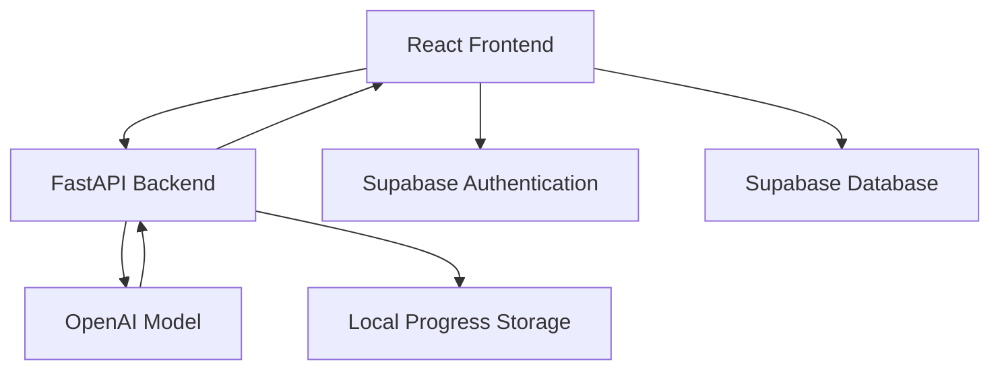

# 🎨 AI Sketch Mentor

**An AI-powered sketch feedback platform that helps artists understand their work, practice intentionally, and track their creative growth.**

Built with React, FastAPI, OpenAI, and Supabase.

<!-- Replace with a real screenshot or GIF once captured -->
<!--  -->

## ✨ Features

- **Sketch Analysis:** Upload artwork or describe a drawing to receive AI-generated feedback.
- **Personalized Mentorship:** Choose your experience level, artistic style, and preferred feedback tone.
- **Structured Critiques:** Review strengths, weaknesses, suggested exercises, and next steps.
- **Skill Dashboard:** Visualize anatomy, shading, perspective, composition, and line confidence.
- **Daily Challenges:** Get drawing exercises to support consistent practice.
- **User Accounts:** Sign in through Supabase authentication.

## 🚀 Quick Start

### Prerequisites

- Node.js and npm
- Python 3.10+
- OpenAI API key
- Supabase project

### 1. Clone the repository

```bash
git clone https://github.com/vihaank1/ai-sketch-mentor.git
cd ai-sketch-mentor
```

### 2. Set up the backend

```bash
cd backend
python3 -m venv .venv
source .venv/bin/activate
pip install -r requirements.txt
```

Create `backend/.env`:

```env
OPENAI_API_KEY=your_openai_api_key
```

Start the API:

```bash
uvicorn main:app --reload
```

Backend: http://127.0.0.1:8000

API documentation: http://127.0.0.1:8000/docs

### 3. Set up the frontend

Open another terminal:

```bash
cd ai-sketch-mentor/frontend
npm install
```

Create `frontend/.env`:

```env
REACT_APP_SUPABASE_URL=your_supabase_project_url
REACT_APP_SUPABASE_ANON_KEY=your_supabase_publishable_or_anon_key
```

Use the environment variable names expected by your `supabaseClient.js`. The example above assumes Create React App.

Start the frontend:

```bash
npm start
```

Open http://localhost:3000.

**Note:** Configure Google OAuth and the appropriate database tables and access policies in Supabase before testing authentication and cloud history.

Never commit actual credentials or `.env` files.

## 🧠 How It Works



**1. Submit artwork**

Users describe their drawing, select their artistic goals, and optionally upload an image.

**2. Generate feedback**

FastAPI sends the request to OpenAI. The model returns structured feedback containing critique, strengths, weaknesses, exercises, and skill estimates.

**3. Visualize improvement**

The frontend displays the returned skill estimates using progress bars and a radar chart.

**4. Build a learning routine**

Daily challenges and saved critiques provide a foundation for continued practice.

*Skill scores are AI-generated estimates, not independently validated measurements of artistic ability.*

## 📋 Example Critique

For a pencil drawing of a hand with inconsistent finger proportions, an illustrative response might look like:

```json
{
  "critique": "The overall hand shape is recognizable, but the finger proportions need more consistency.",
  "strengths": [
    "Clear silhouette",
    "Good initial gesture"
  ],
  "weaknesses": [
    "Inconsistent finger lengths",
    "Limited depth around the knuckles"
  ],
  "practice_exercises": [
    "Sketch hands using simple 3D forms",
    "Draw five hand poses from reference"
  ],
  "next_step": "Focus on palm construction before adding finger details.",
  "confidence_score": 82
}
```

*Illustrative example, not a recorded model evaluation.*

## 🛠️ Tech Stack

| Layer | Technology |
|---|---|
| Frontend | React, JavaScript |
| Backend | Python, FastAPI |
| AI | OpenAI API |
| Authentication | Supabase Auth |
| Cloud storage | Supabase PostgreSQL |
| Local persistence | SQLite, SQLAlchemy |
| Visualizations | Recharts |
| API requests | Axios |

## Engineering Challenges

**Structured AI responses**

Getting useful feedback requires more than a freeform model response. The backend requests a consistent JSON structure so the interface can display critiques and skill scores predictably.

**Combining feedback with progress**

Artistic improvement is difficult to quantify. The project explores how estimated skill scores can support visual progress tracking while recognizing the limitations of AI-based evaluation.

**Authentication and persistence**

Integrating user authentication, sketch history, and progress tracking requires coordinating frontend state with backend and database operations.

## 📈 Roadmap

- [ ] Add a complete visual sketch history gallery
- [ ] Improve consistency and validation of skill scoring
- [ ] Add before-and-after sketch comparisons
- [ ] Persist streaks using calendar-based activity tracking
- [ ] Add automated backend and frontend tests
- [ ] Deploy a publicly accessible demo
- [ ] Collect feedback from artists to evaluate critique quality

## License

No license has been specified yet. Add a `LICENSE` file before declaring an open-source license.

---

**Built to explore how AI can make practicing art more intentional, measurable, and rewarding.**
